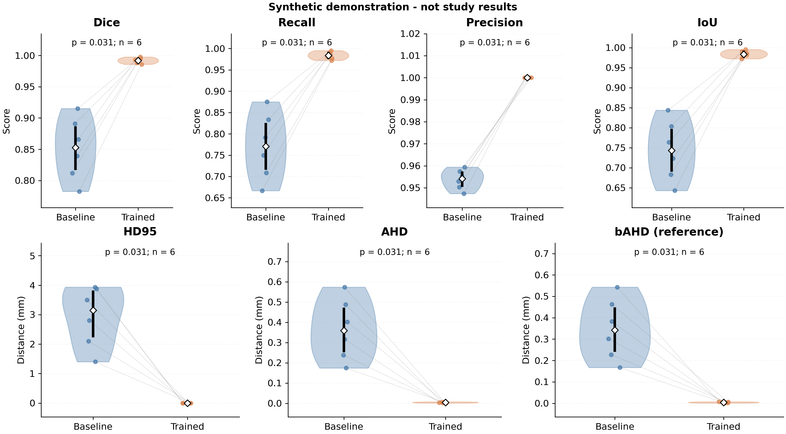
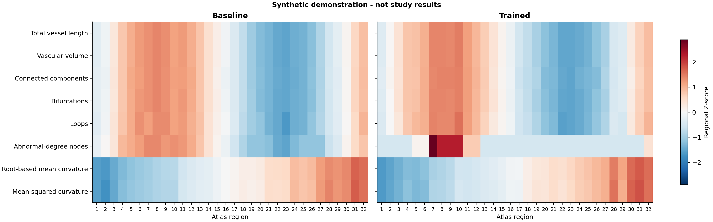

# Pediatric TOF-MRA: segmentation and evaluation

Python companion code for **Pediatric-Trained 3D nnU-Net Improves Cerebrovascular Segmentation in TOF-MRA: Implications for Vascular Quantification**.

This repository implements the study workflow from the supplied conversion, nnU-Net, evaluation, and CaravelMetrics code:

1. Convert explicitly selected TOF-MRA and T1 DICOM series to NIfTI.
2. Prepare manually annotated development data and separate independent test inputs.
3. Apply the adult-trained **2D baseline**, using fold 0 for inference only.
4. Train a separate pediatric **3D full-resolution nnU-Net from scratch**, using fold 0, and predict the same test cases.
5. Evaluate Dice, recall, precision, IoU, HD95, AHD, and bAHD; compare models using paired two-sided Wilcoxon tests and violin plots.
6. Extract CaravelMetrics vessel graphs and regional descriptors; aggregate whole-brain measurements, run age/balanced-sex/regional analyses, and create baseline/trained figures.

All orchestration and analysis are Python. The official `dcm2niix` and nnU-Net programs are called through Python without shell scripts. MATLAB is not required.

**Version 0.2 includes CaravelMetrics.** The study extraction modules are included with attribution; the paper-relevant notebook analyses are implemented directly as Python scripts. See [Caravel setup and execution](docs/CARAVEL_INTEGRATION.md). No MATLAB or notebook execution is required.

## Try the synthetic example

Use Python 3.10 or later. The demonstration needs no DICOM converter, GPU, nnU-Net installation, or trained weights.

```console
python3 -m venv .venv
.venv/bin/python -m pip install -e .
.venv/bin/python -m tof_mra demo --output demo-output
```

On Windows, use `.venv\Scripts\python.exe` in place of `.venv/bin/python`. In the commands below, `tof-study` means the executable in the environment where this package is installed; `python -m tof_mra` is equivalent.

The demo creates small artificial images, annotations, and predictions, then runs preparation, evaluation, statistics, and plotting. It **does not train a model or perform real model inference**. Its numbers are not study results.



## Installation for the actual study

Install `dcm2niix` separately for DICOM conversion. Install nnU-Net in the environment used for model execution:

```console
python -m pip install -e ".[nnunet]"
```

The optional dependency group requests **nnU-Net 2.6.2 and PyTorch 2.6.0**, as reported in the manuscript. The appropriate PyTorch/CUDA build must be available for your hardware; the study used CUDA 12.4. You may instead use your existing nnU-Net environment by setting `nnunet.executable_dir` to its `bin` directory. Recorded Python package versions describe the driver environment; retain the separate nnU-Net environment's package export if using another interpreter.

Patient images, manual annotations, HD-BET brain masks, the baseline model weights, and original saved nnU-Net artifacts are not bundled. Baseline weights must be obtained from their original provider; there is no automatic download of an assumed model.

## 1. DICOM conversion

Create a series-selection CSV, using [the example](examples/dicom_series.example.csv):

| case_id | modality | series_dir |
|---|---|---|
| dev001 | tof | /path/to/selected/TOF/series |
| dev001 | t1 | /path/to/selected/T1/series |

Use a pseudonymous ID and select exactly one intended DICOM series per case/modality. Paths are relative to the CSV unless absolute. Explicit selection replaces the source script's first-match T1 search and unrestricted TOF folder search.

```console
tof-study convert --series-manifest data/dicom_series.csv --output data/converted
```

Outputs are `data/converted/tof/<case_id>.nii.gz` and `data/converted/t1/<case_id>.nii.gz`, with the converter's JSON sidecars and conversion logs. These two modalities remain separate: only TOF-MRA is input to nnU-Net.

For compressed DICOMs requiring an external decoder, configure a command as a JSON array. Source DICOM files are preserved; decompression uses a temporary directory:

```console
tof-study convert --series-manifest data/dicom_series.csv --output data/converted --decompress-command '["dcmdjpeg"]'
```

The containerized decoder used in the source script is also supported:

```console
tof-study convert --series-manifest data/dicom_series.csv --output data/converted --decompress-command '["apptainer","exec","/path/to/dcmdjpeg.sif","dcmdjpeg"]'
```

More than one generated volume is treated as an ambiguous series selection. Conversion errors stop execution and are retained in per-series logs.

## 2. Case manifest and configuration

Copy `configs/study.example.json` to `configs/study.json` and edit it. Configuration paths are resolved relative to the configuration file, regardless of your current directory.

Create a case manifest using [the template](examples/cases.example.csv). Its image/mask paths are relative to the manifest itself. Each row must represent one subject:

| Column | Meaning |
|---|---|
| `case_id` | Unique pseudonymous ID; no NIfTI extension or `_0000` suffix |
| `subject_id` | Subject identifier; defaults to case_id; repeats are rejected |
| `split` | `development` or `test` |
| `tof` | Source TOF-MRA NIfTI |
| `label` | Corresponding manual vessel annotation |
| `brain_mask` | HD-BET brain mask; required for test evaluation by default |
| `t1` | Optional T1 NIfTI, retained for the later CaravelMetrics stage |

The template contains only illustrative rows; it is not the study cohort. The example configuration expects **23 development and 19 test subjects**. Counts are checked rather than inferred from historical script comments mentioning smaller subsets.

If your current data use one NIfTI per subject folder, a manifest can be generated:

```console
tof-study make-manifest --dev-images /path/development_images --dev-labels /path/development_labels --test-images /path/test_images --test-labels /path/test_labels --brain-masks /path/test_brain_masks --output data/cases.csv
```

This command requires subject folders in both image roots. Labels and brain masks may use matching subject folders or flat `<case_id>.nii.gz` and `<case_id>_mask.nii.gz` names. Multiple candidate files cause an error. Review the resulting case correspondence before use. For the flat outputs from `convert`, fill in the manifest template directly.

```console
tof-study --config configs/study.json inspect
tof-study --config configs/study.json prepare
```

`inspect` reports dimensions, physical voxel spacing, orientation, and image/annotation geometry agreement. `prepare`:

- Copies the **development** images/labels into `imagesTr`/`labelsTr`.
- Resamples a development label to the image grid with an identity transform and nearest-neighbor interpolation when geometry differs, matching the supplied training script.
- Stages test images separately in `work/test_inputs`, with `<case_id>_0000.nii.gz` names.
- Keeps test labels outside the nnU-Net dataset.
- Saves source hashes, a manifest snapshot, geometry actions, and configuration provenance.

Existing prepared directories are not merged with a new run. Use a fresh `work_dir` and corresponding nnU-Net paths when starting a different experiment.

### Preserve the study normalization and split

`dataset.channel_name` deliberately remains **`CT`** because the supplied script uses this channel name to select nnU-Net's **CTNormalization**. The images are TOF-MRA; the setting reproduces the normalization choice rather than describing the acquisition modality. Changing this field to `MR` changes preprocessing.

Set `dataset.splits_file` to the original `splits_final.json` when available. Its IDs must match the manifest, its train/validation sets must partition the development cohort, and fold 0 must contain five validation subjects. Otherwise nnU-Net generates its normal five-fold partition, and this workflow trains only fold 0. The resulting file is archived after training. Exact original subject allocation cannot be asserted without the original split file or an equivalent explicit subject list.

## 3. Baseline inference

Configure `baseline.results` to the existing nnU-Net **results root**, containing:

`Dataset666_Vessel/nnUNetTrainer__nnUNetPlans__2d/fold_0/checkpoint_final.pth`

`Dataset666_Vessel` comes from the supplied inference script; change it only if your saved adult model uses a different name. The normal nnU-Net model metadata (`dataset.json`, `plans.json`, checkpoint) must be present in the exported model directory.

```console
tof-study --config configs/study.json predict --model baseline --dry-run
tof-study --config configs/study.json predict --model baseline
```

This stage never trains or modifies the baseline. It uses the `2d` configuration, fold 0, explicit final checkpoint, default mirroring TTA, and sliding-window step size 0.5. Checkpoint/configuration/TTA are recorded and configurable.

## 4. Pediatric training and independent inference

```console
tof-study --config configs/study.json plan --dry-run
tof-study --config configs/study.json train --dry-run
tof-study --config configs/study.json plan
tof-study --config configs/study.json train
tof-study --config configs/study.json predict --model pediatric
```

Planning uses dataset-integrity verification. Training calls the official `nnUNetTrainer` in `3d_fullres`, fold 0, **without pretrained weights**. The source script's disabled `torch.compile` setting and thread/augmentation-worker limits are retained. Training from scratch requires a fresh fold output directory.

The default trainer supplies the reported 1000-epoch schedule, losses, optimizer, and augmentations. Dataset-specific spacing, patch size, and intensity statistics are generated by nnU-Net and recorded in its plans/fingerprint. They must be checked against the original saved artifacts for exact numerical reproduction; this repository does not fabricate a plans file from rounded manuscript values.

Both prediction stages consume the same staged test inputs and save one mask per case:

- `work/predictions/baseline/<case_id>.nii.gz`
- `work/predictions/pediatric/<case_id>.nii.gz`

Command arguments, selected environment settings, console logs, and available package versions are recorded in `work/logs`. Generated dataset metadata, plans, fingerprint, and split are copied to `work/provenance` when available.

## 5. Evaluate and compare traditional metrics

```console
tof-study --config configs/study.json evaluate
tof-study --config configs/study.json compare
```

Evaluation checks 3D shape and the complete spatial affine of the source image, reference, prediction, and brain mask. It stops on missing cases or geometry disagreement. Predictions/references are not silently resampled during evaluation.

The supplied metric scripts apply an **HD-BET brain mask to both the prediction and reference**; this is the default here. Brain masks must already exist on the TOF grid. This repository does not infer unreported HD-BET generation settings. For a deliberately unmasked analysis use `evaluate --without-brain-mask` or set `evaluation.brain_mask_policy` to `none`; the choice is recorded.

Evaluation exports both bAHD definitions; comparison uses the reference-normalized one by default to match the manuscript. See the methodological difference below before comparing old and new numbers.

Comparison uses case IDs, rejects duplicate/missing pairs by default, and calculates nominal two-sided paired Wilcoxon tests independently for the seven reported metrics. F1 is retained in evaluation tables for compatibility but is not tested again because it equals Dice. Every reported test and plotted panel states the actual paired sample size. Medians and quartiles are calculated on the same finite pairs used for that test.

Generated files:

| File | Contents |
|---|---|
| `work/evaluation/baseline.csv`, `pediatric.csv` | Subject-level scores, both bAHD variants, surface/foreground counts |
| Corresponding `.json` files | Mask policy, distance definitions, case IDs, versions |
| `work/comparison/traditional_metrics_statistics.csv` | Medians, Q1/Q3, paired changes, Wilcoxon statistics and p-values |
| `work/comparison/paired_metrics.csv` | Explicitly paired subject-level values |
| `work/comparison/pairing_audit.json` | Case-set differences and any explicitly permitted non-finite exclusions |
| `work/comparison/comparison_metadata.json` | Settings, source CSV hashes, versions, and actual font |
| `work/comparison/traditional_metrics.svg`, `.png`, `.pdf` | Violin plots, paired observations, median diamonds and IQR bars |

SVG labels remain editable text. Arial is used if installed; otherwise the recorded fallback is DejaVu Sans.

### Important difference: bAHD in the source script and manuscript

Let `S` be the sum of all nearest-surface distances in both directions:

| Exported column | Definition | Origin |
|---|---|---|
| `Balanced_AHD_reference_mm` | `S / (2 * number_of_reference_surface_points)` | Manuscript equation |
| `Balanced_AHD_prediction_mm` | `S / (2 * number_of_prediction_surface_points)` | Supplied `distance_metrics(1).py` implementation |

These values differ when surface sizes differ. Both are retained; no historical result is silently relabeled. To compare the original implementation, select:

```console
tof-study --config configs/study.json compare --bahd-normalization prediction
```

HD95 is the **maximum of the two directional 95th percentiles**, matching the source code. AHD is the arithmetic mean of the two directional mean distances. Surfaces are obtained with 6-connected binary erosion, and distances are measured between surface voxel centers in physical coordinates. NIfTI spatial coordinates are expected in millimeters. The full affine preserves rotation/translation and handles oblique geometry; on ordinary orthogonal grids its Euclidean distances agree with the original spacing-based calculation.

Both-empty overlap scores are 1. Distance metrics remain infinite if either mask is empty, following the original script. Comparison stops on non-finite scores by default. `--nonfinite-policy drop` permits explicit paired exclusion per metric and records the removed IDs and resulting sample size.

### Existing metric CSVs

Historical overlap and distance CSVs can be combined without recomputing predictions:

```console
tof-study merge-reports --overlap baseline_overlap.csv --distance baseline_distance.csv --output baseline.csv
tof-study merge-reports --overlap trained_overlap.csv --distance trained_distance.csv --output trained.csv
tof-study compare --baseline baseline.csv --trained trained.csv --output comparison --expected-pairs 19 --bahd-normalization prediction
```

`Filename` is accepted when `case_id` is absent. NIfTI extensions are removed, and rows are joined by ID. The historical `Balanced_AHD_mm` column from the supplied script is treated as **prediction-normalized**. The reference-normalized value cannot be reconstructed from that CSV column alone without the surfaces or surface cardinalities.

The manuscript's Figure 5 mentions 12 retained plotted reports and full-cohort tests on 19 subjects. This code recomputes tests from the provided pairs; a 12-case input cannot be presented as a newly computed 19-case test. Explicitly change `--expected-pairs` for a subset analysis and report that sample size.

## 6. CaravelMetrics extraction and analysis

Install the optional extraction dependencies. FSL is an additional external requirement when registering the atlas locally; it is unnecessary if you supply an atlas already registered to each subject’s TOF grid.

```console
python -m pip install -e ".[caravel]"
tof-study --config configs/study.json caravel-demographics --source /path/IXI_METADATA.xlsx --id-column IXI_ID --output data/demographics.csv
tof-study --config configs/study.json caravel-extract
tof-study --config configs/study.json caravel-collect
tof-study --config configs/study.json caravel-analyze
```

Populate the `caravel` configuration section with the original atlas, its numeric label map, and metadata. If metadata IDs differ from the manifest, add `--case-map data/case_mapping.csv` to the import command; its columns are `source_id,case_id`. Correspondence is never inferred from row order. The original clinical workbook is not distributed in the repository.

The extractor preserves the supplied skeletonization, graph refinement, component cutoff, smoothing, root/path curvature, and radius estimation calculations. Both model outputs use the same registered atlas per subject. The six extensive descriptors are summed across regional subgraphs; the two curvature descriptors use vessel-length weighting. This definition is kept distinct from direct whole-graph topology.

Analyses use exactly the eight reported descriptors. Pearson/Spearman age tests, pooled-variance sex t-tests/Cohen’s d, regional ANOVA/Kruskal–Wallis/eta-squared, and separate eight-descriptor FDR corrections follow the paper. The sex subgroup is selected once and shared by both models. Its IDs and bin counts are saved. Regional tests retain the paper’s exploratory interpretation because they do not model within-subject dependence.

Figures include age correlations/scatter plots, sex effect sizes, original/balanced age distributions, regional profiles with one shared colorbar, and main/supplementary atlas maps. SVG, PNG, and PDF are exported. Regional standardization uses sample SD (`ddof=1`), matching the source notebook; tests use unstandardized subject-level values.

A second CPU demonstration exercises collection, aggregation, statistics, and plotting from explicitly artificial regional summaries and an artificial label atlas:

```console
tof-study caravel-demo --output caravel-demo-output
```



This statistical demonstration does not perform registration or graph extraction. The extraction tests separately execute the real graph/metric modules on a small synthetic vessel and verify physical-coordinate atlas assignment. The original clinical results still require the study data, masks, atlas files, saved model artifacts, and original balanced-subgroup IDs if exact historical selection is needed.

## Source mapping and reproducibility

| Supplied file | Python replacement |
|---|---|
| `dcm2nii_for_TOF_and_T1(2).sh` | `conversion.py`: explicit series selection, dcm2niix, optional decompression |
| `check_size_test(2).sh` | `dataset.py` / `inspect`: this supplied file is an output log, not executable shell code |
| `run_nnunet_inference(5).sh` | `nnunet.py` / `predict --model baseline` |
| `train_and_test_nnunetv2_3D(4).sh` | `dataset.py`, then `plan`, `train`, `predict --model pediatric` |
| `overlap_metrics(1).py` | `metrics.py`, `evaluation.py` |
| `distance_metrics(1).py` | `metrics.py`, `evaluation.py`, with separately named bAHD variants |
| Both `.mlx` files | `comparison.py`, `plotting.py`; baseline versus pediatric comparisons only |

The supplied `.mlx` contents are not reliable indicators of their filenames: one refers to an earlier nnU-Net/A2V comparison, and the file named for Hausdorff comparison contains overlap plots. Their statistical intent was translated to Python and aligned with the final paper's seven metrics. A2V is not included.

See [reproducibility notes](docs/REPRODUCIBILITY.md) for the outstanding original artifacts, numerical conventions, and validation record. Source-file hashes are recorded in `SOURCE_PROVENANCE.json`. Original files, patient identifiers, absolute research-server paths, images, and weights are not distributed in this repository.

## Tests

```console
python -m unittest discover -s tests -v
```

Tests cover conventional metrics, geometry, subject separation, pair matching, brain masking, command construction, Caravel aggregation/statistics, and real graph extraction/atlas assignment on a synthetic vessel when optional dependencies are installed. GitHub Actions runs the two demonstrations and an optional-extraction test job. Actual FSL registration, clinical DICOM decoding, and GPU training/inference require local study resources and are not claimed as validated by these tests.

## Related software

- [nnU-Net](https://github.com/MIC-DKFZ/nnUNet), with interfaces checked against [v2.6.2](https://github.com/MIC-DKFZ/nnUNet/tree/v2.6.2).
- [dcm2niix](https://github.com/rordenlab/dcm2niix).
- [CaravelMetrics](https://github.com/i-vesseg/CaravelMetrics), the downstream framework used in the study.

The manuscript is currently a draft; no publication DOI or model-release URL has been assigned in this repository. A repository license has not been selected on the authors' behalf. Third-party software retains its own licensing and citation requirements.

